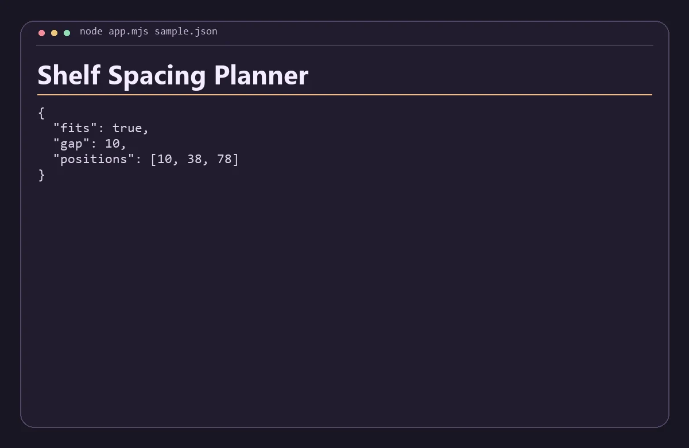

# Shelf Spacing Planner

Find equal clearance around objects on a shelf and report their start positions.



## Run

Install Node.js 22 or newer. Run these commands from the repository root.

```sh
node app.mjs sample.json
```

Replace `sample.json` with a JSON file following the same structure. The app prints a JSON report to standard output.

Use the same unit for shelf width, minimum gap and item widths. Gaps at the two ends match the gaps between neighboring items.

## Verify

Run `python check.py` with Python 3.11 or newer after the build step when applicable. The check verifies the bundled scenario and confirms that an invalid input returns an error.
